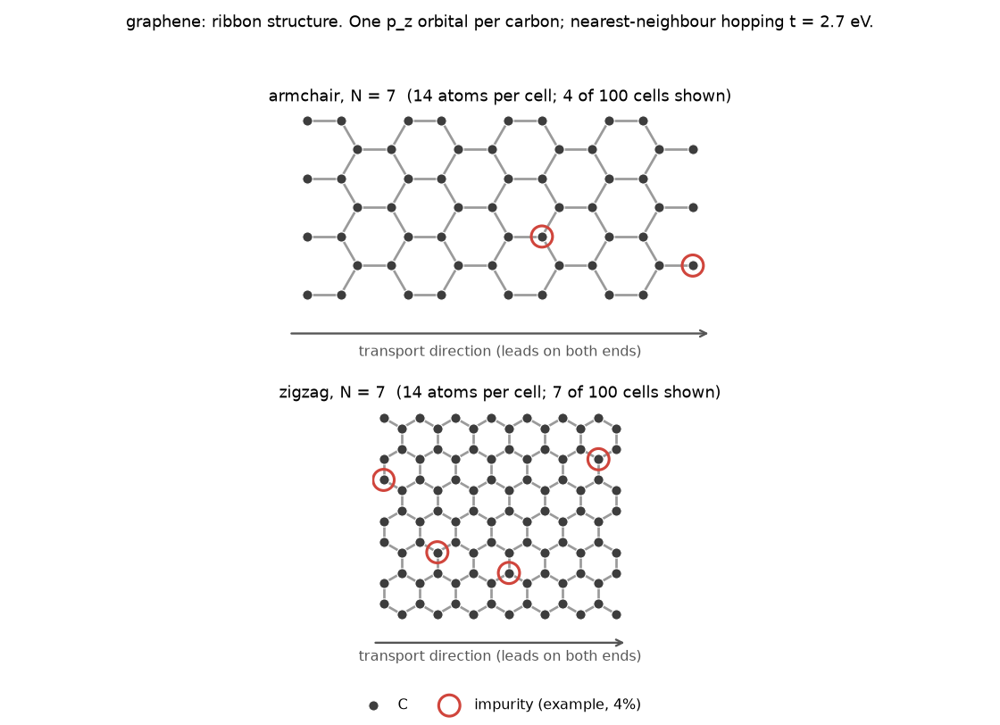
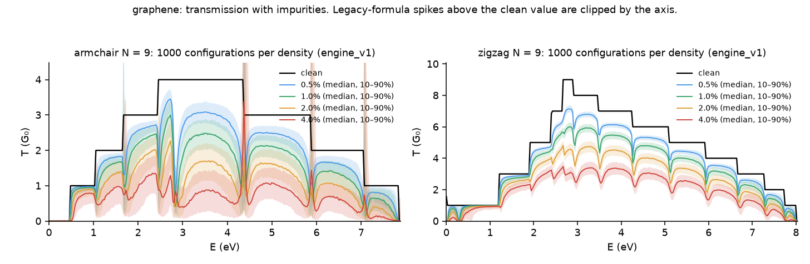

# Inverse Problems in Quantum Transport

We simulate electron transmission T(E) through nanoribbons of 2-D materials, then solve the inverse problem: from one transmission spectrum, read the ribbon's **material, edge, width and impurity density**, and say when a spectrum is unlike anything known.

<table>
<tr><td></td>
<td></td></tr>
<tr><td><sub>Graphene ribbons (armchair, zigzag) with example impurities</sub></td>
<td><sub>Transmission of a graphene ribbon at 0.5–4% impurities</sub></td></tr>
</table>

## Materials

Ribbons are built from geometry with a tight-binding engine. Transmission is computed with recursive Green's functions between clean leads, and impurities are random on-site shifts. Each material has its own page, covering the model, how its data is generated, and figures:

| Material | Model | README |
|---|---|---|
| Graphene | nearest-neighbour p_z, t = 2.7 eV | [graphene](docs/materials/graphene/README.md) |
| hBN | honeycomb with ±Δ on-site (Galvani 2016) | [hbn](docs/materials/hbn/README.md) |
| Phosphorene | 5-hopping model (Rudenko & Katsnelson 2014) | [phosphorene](docs/materials/phosphorene/README.md) |
| MoS₂ | 3-band d-orbital model (Liu et al. 2013) | [mos2](docs/materials/mos2/README.md) |
| Triangular lattice | toy model, one orbital | [triangular](docs/materials/triangular/README.md) |
| Square strip | toy model, one orbital | [square](docs/materials/square/README.md) |

Eight further materials have no page of their own yet: WS₂, MoSe₂, WSe₂ (3-band model, Liu et al. 2013), silicene and germanene (Dirac), and the kagome, Lieb and checkerboard lattices (flat bands). The 12 non-graphene materials are simulated at widths N = 5–50, with devices of about 2,000 atoms.

The shared pipeline (transport, disorder, data stores) is described in [`docs/materials/README.md`](docs/materials/README.md).

## Shazam: identifying a spectrum

Shazam takes one transmission spectrum, on any energy window, and returns the closest known device: its material, edge and width, its impurity density with a 90% interval, or "no match" when the spectrum is unlike anything known. Its input is label-free: a shared 0–8.3 eV axis, spike removal and a log scale. It has two versions:

- **Fingerprint library** (`atlas_v4m`, production). A convolutional autoencoder embeds the input, the 15 nearest reference spectra vote, and a calibrated distance flags unseen spectra.
- **Ensemble lookup** (`lookup_v4`, candidate). No trained model: each device is stored as the median and spread of its disordered spectra, interpolated over 0–5% impurity density, and a spectrum is matched by a Bayesian posterior over device and density.

| Ensemble lookup, held-out configurations (339 devices, 13 materials) | Result |
|---|---|
| Right device (203,400 spectra) | 99.966% |
| Each material named as itself | 99.994–100% |
| Impurity density | median relative error 3.2%; 90% interval holds 88.9–92.5% per material |
| A whole material hidden from the catalogue | answered "no match" 98.3–100% |
| Unseen square lattice | answered "no match" 100% |
| Time per lookup | about 100 ms |

The lookup is weakest above 5% impurity density and in narrow energy windows, where many devices share the same zeros. For 7- and 9-AGNR, a per-width regressor gives the impurity count with MAE about 2 and 90% intervals. Code: [`notebooks/material_atlas/`](notebooks/material_atlas/).

## Key findings

- **Concentration is recoverable to about 4–5%** of the impurity count from one spectrum, and using the whole spectrum helps more than changing the model.
- **Identification works without label leakage.** Earlier 100% results were circular, because they normalised by the true material's spectrum (Bug #8). Shazam's input is the same for every spectrum.
- **A larger catalogue costs only where information is missing.** With 339 devices and widths 5–50, the lookup still names 99.97% correctly and confuses a width 41 times in 203,400 spectra.
- **An autoencoder over all 339 devices** reconstructs spectra about 40% better than PCA at the same size and identifies devices as well as the full spectrum (99.87%). It does not read concentration better, and larger latent sizes (128) identify worse than 32 or 64.
- **The exact impurity arrangement is not recoverable** from one spectrum, only the count.
- **Checking T against the channel count is not enough.** New ribbon builders must also match the bulk band structure, which caught misplaced MoS₂ bonds (Bug #10).

## Data rules

1. Split train, validation and test **by configuration seed**: a seed's impurities are nested across concentrations (Bug #7).
2. Make everything before identification **label-free** (Bug #8).
3. **Round T to 3 decimals** before dividing by a clean spectrum (Bug #6).
4. Use square-lattice data from `ca_sq.py` only; the `CA.ipynb` CSVs are corrupt.

## Repository

```
notebooks/tbribbon/         tight-binding engine: lattices, leads, transport, disorder, data generation
notebooks/material_atlas/   Shazam: atlaslib, builds, unknown flag, concentration (stage 3)
notebooks/agnr/             earlier 7/9-AGNR models, physics library (agnr_lib.py), agent
notebooks/square_lattice/   square-lattice generator (ca_sq.py) and studies
docs/materials/             one README per material, with figures
docs/report/                interactive report and its figure scripts
tests/                      pytest suite
LOGBOOK.md                  every build, result and bug (source of truth)
```

## Getting started

```bash
pip install torch numpy scipy pandas matplotlib xgboost lightgbm scikit-learn
export PYTHONPATH=notebooks/material_atlas:notebooks

python -m pytest -q                                   # run the tests
python notebooks/tbribbon/generate_clouds.py --help   # generate transmission data
python docs/materials/make_figures.py                 # redraw the material figures
python notebooks/material_atlas/build_lookup.py       # build the ensemble lookup catalogue
python notebooks/material_atlas/eval_lookup.py        # evaluate it
python notebooks/material_atlas/train_ae.py --latent 64   # train the all-ribbons autoencoder
```

Generated data lives outside the repository, under `~/atlas_store/` (about 10 GB; the stores are listed in [`docs/materials/README.md`](docs/materials/README.md)).

## More

- [`LOGBOOK.md`](LOGBOOK.md): all builds, numbers and bug fixes.
- [`docs/report/`](docs/report/): the interactive report and its figure scripts.
- [`docs/agnr-models.md`](docs/agnr-models.md): the earlier 7/9-AGNR models (PINN, transformer, XGBoost), defect reconstruction, the inference agent and the benchmark tables.
- [`README_COMBINED.md`](README_COMBINED.md): the legacy dataset catalogue.

Energies in results before BUILD-21 are in units of the hopping t (graphene: t = 2.7 eV, so "0–3 eV" there means 0–8.1 eV).
